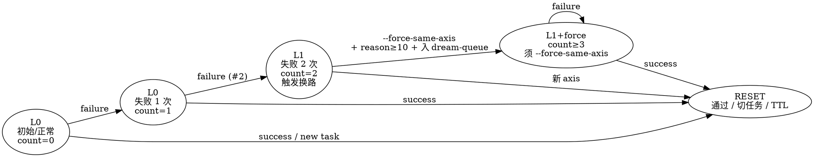

# 2 次换路（量化版）

> G5 闭环：把 `anti-rationalization.md` 中"同一路径失败 2 次必须换路"这条软约束，落到可计数、可校验、可阻断的硬规则上。

## 1. 为什么需要量化

`anti-rationalization.md` 已有 L1 触发条件「同一路径失败 2 次」，但缺三件事：

1. **"路径"没有定义** —— 改个变量名算同一路径吗？换个文件算吗？人类语义判断不可复现。
2. **失败次数没有持久化** —— 主对话切了 task 重启后从 0 开始算，绕过了换路硬门禁。
3. **第 3 次尝试没有 hook** —— 完全靠 AI 自觉读规则，碰到合理化（"这次不一样"）就破防。

本规则给三者各一个机械化答案。

## 2. 路径（axis）定义

一条"路径"由如下三元组唯一确定：

```
axis_id = hash(hypothesis_id, tool_class, target_file)
```

| 字段 | 含义 | 示例 |
|------|------|------|
| `hypothesis_id` | 当前修复假设（人类语义） | "vite base 没生效" |
| `tool_class` | 操作类别 | `edit_yaml` / `edit_ts` / `restart_pod` / `change_dns` |
| `target_file` | 主要操作对象（文件 / 配置 / 对象 ID） | `eam-v2/vite.config.ts` |

**判定规则：**

- 三元组完全一致 → 同一 axis（计数器累加）
- `target_file` 不同但 `hypothesis_id + tool_class` 相同 → 仍视为同一 axis 的拓扑扩展（计数器累加，但 dream-queue 标 "axis_extension"）
- `hypothesis_id` 改变 → 新 axis（计数器从 0 起）

## 3. 计数器与状态机



**关键边：**

- L0a→L1（第 2 次失败）：**强制 prompt 提示换路**；不阻断，但写入 dream-queue。
- L1→L1+force（第 3 次失败前）：**默认拒绝**；除非显式 `--force-same-axis="<reason ≥10 字符>"`，否则不允许在同一 axis 上发起新尝试。
- 任意状态 → RESET：以下任一条件触发
  - `verify-counter.sh reset` 显式调用
  - 同 axis 一次 success
  - 主对话 `task_id` 改变
  - 计数器条目 `last_failure_at` 距今超过 24h（TTL）

## 4. 持久化

状态文件：`$HARNESS_ROOT/.gbrain/verify-counter.json`

```json
{
  "schema_version": 1,
  "tasks": {
    "<task_id>": {
      "axes": {
        "<axis_id>": {
          "hypothesis_id": "vite base 没生效",
          "tool_class": "edit_yaml",
          "target_file": "eam-v2/vite.config.ts",
          "count": 2,
          "first_failure_at": "2026-05-26T10:12:33Z",
          "last_failure_at": "2026-05-26T10:48:11Z",
          "force_used": false,
          "force_reason": null
        }
      }
    }
  }
}
```

## 5. 接口（verify-counter.sh）

| 子命令 | 行为 | 退出码 |
|--------|------|--------|
| `inc <task_id> <axis_id> [--meta <key=val>...]` | 计数器 +1，写入元数据；返回新 count | 0 |
| `check <task_id> <axis_id>` | 仅查询，不写入；输出当前 count + 状态等级 | 0=L0/L0a, 1=L1, 2=L1+force_required |
| `reset <task_id> [axis_id]` | 重置某 task 的某 axis（或整个 task）的计数 | 0 |
| `list <task_id>` | 列出该 task 全部 axis 的状态 | 0 |
| `tick` | 扫一遍全表，TTL 过期项自动清理 | 0 |

**强制换路 hook**：`check` 返回 ≥1 时，调用方（subagent / 主对话）必须：

1. 输出 prompt：`"已在 axis=<id> 累计失败 <n> 次，按 anti-rationalization.md L1 必须换路：换 hypothesis / 换 tool_class / 换 target_file 任一维度"`
2. 若用户/调用方仍要继续同 axis：必须显式 `--force-same-axis="<reason>"`，否则视为违规。
3. force 一旦使用，自动写 `dream-queue/pending-force-same-axis-<task>-<axis>.yaml` 作为周复盘必读项。

## 6. 与 anti-rationalization.md 的关系

| 维度 | anti-rationalization.md | loop-break-quantified.md |
|------|-------------------------|--------------------------|
| 触发条件 | "同一路径失败 2 次" | axis 三元组 + 持久化 count ≥ 2 |
| 换路要求 | "换 hypothesis / tool / 范围" | 同上，但状态机强制 |
| 升级 | L1 → 五步调试 | L1 → 强制 prompt + force token |
| 第 3 次尝试 | 靠 AI 自觉 | 默认拒绝，须 --force-same-axis + reason |

**软规则不替代，硬规则只补强；两者必须共同生效。**

## 7. 启用与迁移

| 阶段 | 模式 | 行为 |
|------|------|------|
| 启用日 ~ 2026-06-09 | `warn_only` | check 仅 prompt 提示，不阻断；force 不必填 |
| 2026-06-09 起 | `enforce` | check ≥1 强制 prompt；count ≥2 同 axis 必须 --force-same-axis |

`enforce` 切换需在 `governance/policies/governance-rules.yaml` 增加 `loop_break.mode: enforce` 配置项（待 Wave 5 一并升级）。

## 8. 与现有评分的联动

`risk-score.py` 中 `subagent_rejection / plan_revision_rate` 已经是宏观信号；`verify-counter` 是微观信号：

- 高风险时（risk-score=high），自动把 `loop_break.warn_only` → `enforce`（无需手工切）
- L1+force 触发后 24 小时内累计 ≥3 次同任务 → 在 `events.jsonl` 写 `force_same_axis_excessive`，下次 risk-score 计算时升权

## 9. 测试与自检

```bash
# 自检：第 1 次失败
bash tools/governance/verify-counter.sh inc demo-001 axis-A --meta hypothesis="X" tool="edit_yaml" file="a.yml"
# count=1 期望

bash tools/governance/verify-counter.sh check demo-001 axis-A
# count=1, level=L0a (warn_only 不阻断；enforce 也不阻断)

bash tools/governance/verify-counter.sh inc demo-001 axis-A
bash tools/governance/verify-counter.sh check demo-001 axis-A
# count=2, level=L1 (enforce 起强制 prompt)

bash tools/governance/verify-counter.sh inc demo-001 axis-A
# enforce 模式应拒绝（exit 2），warn_only 模式应通过 + 标记 force_required

bash tools/governance/verify-counter.sh reset demo-001 axis-A
bash tools/governance/verify-counter.sh check demo-001 axis-A
# count=0, level=L0
```

## 10. 不在范围

- 不替代 G7 风险评分（宏观）
- 不替代 anti-rationalization.md L0-L4（语义层）
- 不约束跨任务的同 axis（task_id 隔离）
- 不强制要求所有 hook 都集成（先在 systematic-debugging / TDD 红绿失败链路接入）
