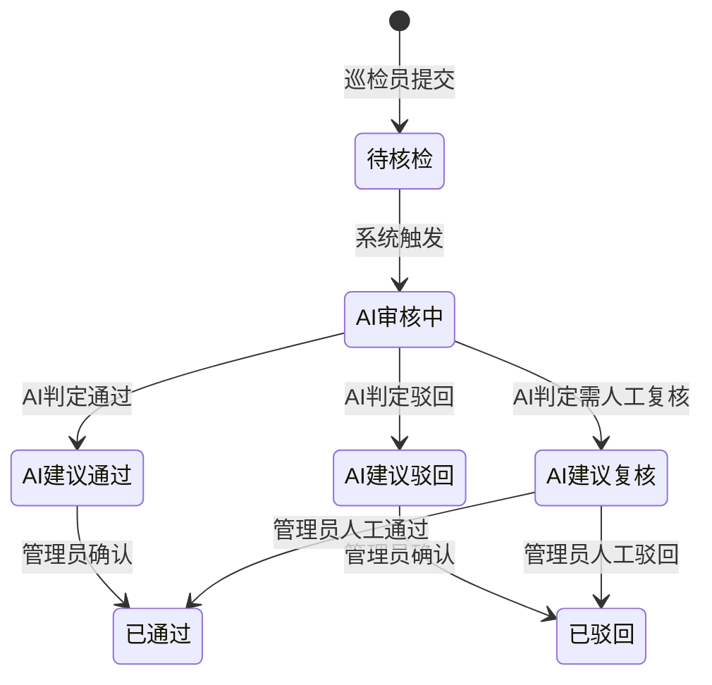

# PRD → AI-Ready 附录转换 Skill

将人类可读的 PRD 转换为 AI Agent 可直接消费的结构化附录。

---

## 转换流程

### Step 1：提取功能清单

从 PRD 中提取所有需要实现/变更的功能点：

- 逐页面、逐模块扫描
- 每个功能点标注：
  - **类型**：新增 / 修改已有 / 删除
  - **所属页面**
  - **所属模块**
  - **UI 变化**：描述界面上的具体变化
  - **逻辑变化**：描述业务逻辑、状态枚举、计算规则
  - **用户交互**：描述用户操作流程（仅与变更相关的部分）

输出格式：

```
## 涉及页面总览

| 页面 | 功能点数量 | 改动类型 |
|------|-----------|---------|
| 阵地盘点列表 | 3 | 新增2 + 修改1 |
| AI审核后台 | 5 | 全新页面 |

## 功能清单

### 页面：阵地盘点列表

#### 模块：表格列

**功能 F-001：新增「AI建议」列**
- 类型：新增
- UI 变化：在「核检状态」列之后新增「AI建议」列
- 逻辑变化：
  - 红色标签「驳回」：当 aiSuggestion === 'rejected'
  - 黄色标签「复核」：当 aiSuggestion === 'review'
  - 绿色标签「通过」：当 aiSuggestion === 'passed'
  - 显示「-」：当 aiSuggestion 为空或未知值
- 用户交互：仅展示，无交互
```

### Step 2：生成术语表（SPEC）

从功能清单中提取所有业务术语和字段定义：

```
## 术语表

| 术语 | 英文/字段名 | 定义 | 枚举值 | 备注 |
|------|-----------|------|--------|------|
| AI建议 | aiSuggestion | AI 对巡检记录的审核建议 | rejected/review/passed | 由AI审核服务自动生成 |
| 核检状态 | checkStatus | 人工核检的审核状态 | pending/approved/rejected | 与AI建议独立，人工判定 |

## 字段定义

### 接口：获取盘点列表（GET /api/patrol/list）

#### Request 新增字段
| 字段 | 类型 | 必填 | 说明 |
|------|------|------|------|
| aiSuggestion | string | 否 | 筛选条件：AI建议类型 |

#### Response 新增字段
| 字段 | 类型 | 说明 |
|------|------|------|
| aiSuggestion | string \| null | AI审核建议结果 |
```

### Step 3：生成 Mermaid 图

根据功能逻辑自动生成对应类型的 Mermaid 图：

**状态流转** → 状态图：


**流程步骤** → 流程图
**接口交互** → 时序图
**条件判断** → 决策表或流程图

### Step 4：生成 Gherkin 场景

为每个功能点生成 Gherkin 验收场景。

**规则：**
- 每个功能点至少 1 个正常场景 + 关键异常场景
- 使用具体的数据值，不用泛化描述
- 场景名称清晰描述测试意图
- 中文编写，关键字用英文（Feature / Scenario / Given / When / Then / And）

```gherkin
Feature: 阵地盘点列表 - AI建议列

  Scenario: 展示AI建议为"驳回"的标签
    Given 用户已登录并进入「阵地盘点」页面
    And 列表中存在一条巡检记录，其 aiSuggestion 值为 "rejected"
    When 页面加载完成
    Then 该记录的「AI建议」列显示红色标签
    And 标签文字为「驳回」

  Scenario: 展示AI建议为"复核"的标签
    Given 用户已登录并进入「阵地盘点」页面
    And 列表中存在一条巡检记录，其 aiSuggestion 值为 "review"
    When 页面加载完成
    Then 该记录的「AI建议」列显示黄色标签
    And 标签文字为「复核」

  Scenario: 展示AI建议为"通过"的标签
    Given 用户已登录并进入「阵地盘点」页面
    And 列表中存在一条巡检记录，其 aiSuggestion 值为 "passed"
    When 页面加载完成
    Then 该记录的「AI建议」列显示绿色标签
    And 标签文字为「通过」

  Scenario: AI建议为空时显示占位符
    Given 用户已登录并进入「阵地盘点」页面
    And 列表中存在一条巡检记录，其 aiSuggestion 值为 null
    When 页面加载完成
    Then 该记录的「AI建议」列显示「-」

Feature: 阵地盘点列表 - AI建议筛选

  Scenario: 按AI建议"驳回"筛选
    Given 用户已登录并进入「阵地盘点」页面
    When 用户点击「AI建议」筛选下拉框
    Then 下拉选项包含：驳回、复核、通过
    When 用户选择「驳回」
    Then 列表接口请求参数包含 aiSuggestion = "rejected"
    And 列表仅展示 AI建议为「驳回」的记录
```

### Step 5：歧义标记与确认

在转换过程中，如果发现 PRD 描述不明确的地方：

- 编号标记每个歧义点
- 提供 2-4 个可能的理解选项（标注 A-D）
- PM 可快速用"1B, 2A, 3D"的格式回复

```
## ❓ 待确认项

1. 「AI建议」筛选是否支持多选？
   A. 单选（同一时间只能筛选一种AI建议）
   B. 多选（可同时筛选"驳回"和"复核"）

2. AI建议数据是实时计算还是定时更新？
   A. 实时：每次打开列表页时调用AI服务计算
   B. 定时：后台定时任务批量计算，前端只读取结果
   C. 触发式：巡检员提交时触发一次AI计算

3. 当AI服务不可用时，「AI建议」列如何展示？
   A. 显示「-」（与数据为空一致）
   B. 显示「计算中」
   C. 显示「服务异常」并标红
```

---

## 输出文件结构

转换完成后，生成以下结构的附录文档：

```
# AI-Ready 附录

## 1. 涉及页面总览（表格）
## 2. 功能清单（按页面-模块组织）
## 3. 术语表与字段定义（SPEC）
## 4. 状态图/流程图/时序图（Mermaid）
## 5. 验收场景（Gherkin）
## 6. 待确认项（如有）
```

## Appendix（执行强调，不引入新规则）
<!-- managed-by: skill-evolution; do-not-edit-manually -->

_无_
